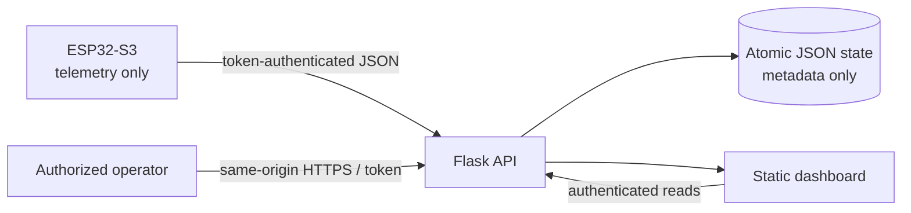

# USB Sentinel

USB Sentinel is a defensive USB-device auditing, IoT telemetry, and security-evidence metadata platform for authorized laboratory and administrative use.

It provides a small Flask API, a responsive browser dashboard, and safe ESP32-S3 telemetry firmware. It **does not** inject keystrokes, execute host commands, download scripts, collect credentials, or store evidence-file contents.

> Status: early-stage reference implementation. The API is covered by automated tests and the firmware is build-validated in CI. Physical hardware behavior is not claimed until independently verified and documented.

## Capabilities

- Authenticated session creation and isolation.
- Sanitized ESP32-S3 telemetry and LED-state reporting.
- Evidence metadata records (name, type, size, optional SHA-256) without file bytes.
- Authorized event timeline and administrative audit log.
- Atomic JSON persistence, backup recovery, retention limits, request-size limits, and rate limiting.
- Clear labels for simulated events.
- Responsive dashboard with session selection and connection/error state.

## Architecture



Flask is the single production backend. The previous Node and PowerShell implementations were removed because they duplicated APIs and were outside the defensive scope.

## Quick start

```bash
python -m venv .venv
source .venv/bin/activate        # Windows: .venv\Scripts\activate
pip install -r requirements.txt
cp .env.example .env             # configure values in your shell or service manager
export USB_SENTINEL_API_TOKEN="$(python -c 'import secrets; print(secrets.token_urlsafe(32))')"
python app.py
```

Open `http://127.0.0.1:5000` and enter the same API token. The token is retained only in the current browser tab.

The service intentionally defaults to localhost. See [docs/DEPLOYMENT.md](docs/DEPLOYMENT.md) before exposing it to a laboratory network.

## Create a session

```bash
curl -X POST http://127.0.0.1:5000/api/sessions \
  -H "X-API-Key: $USB_SENTINEL_API_TOKEN" \
  -H "Content-Type: application/json" \
  -d '{"label":"Authorized bench test","source":"operator","simulated":false}'
```

Use the returned UUID in `firmware/include/config.h`. See [firmware/README.md](firmware/README.md).

## Development

```bash
pip install -r requirements-dev.txt
ruff check app.py tests
pytest -q
npm run check
```

Firmware compilation:

```bash
cp firmware/include/config.example.h firmware/include/config.h
pio run -d firmware
```

## Documentation

- [Technical audit](AUDIT.md)
- [Architecture](ARCHITECTURE.md)
- [API reference](docs/API.md)
- [Secure deployment](docs/DEPLOYMENT.md)
- [Threat model](THREAT_MODEL.md)
- [Contributing](CONTRIBUTING.md)
- [Security policy](SECURITY.md)

## Safety and limitations

- Use only with explicit authorization and informed consent.
- Never submit credentials, browser content, private keys, tokens, or evidence-file bytes.
- USB Sentinel does not independently enumerate arbitrary USB devices with the current firmware architecture.
- Tokens sent over plain HTTP can be intercepted. Use a TLS reverse proxy for any non-loopback deployment.
- No software is completely secure; review the threat model and residual risks.

## License

Released under the [MIT License](LICENSE). No adoption, user-count, download, or security-certification claims are made.
